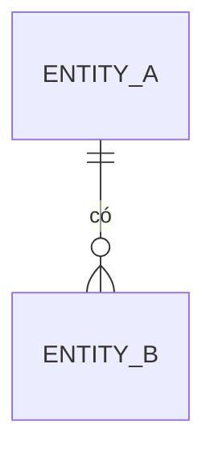

# Data model

> Viết bởi `sa-solution-design` (`/sa-design data`). Độc lập công nghệ cho đến khi ADR-001 Accepted; sau đó ghi thêm kiểu dữ liệu cụ thể và công cụ migration.

## 1. Sơ đồ thực thể

## 2. Thực thể
### <Tên thực thể> (REQ-…)
| Thuộc tính | Kiểu | Bắt buộc | Ràng buộc (unique, khoảng giá trị, FK) | Dữ liệu cá nhân? | Ghi chú |
|---|---|---|---|---|---|
| id | | Có | PK | Không | |

## 3. Quy tắc toàn vẹn
| ID | Quy tắc | Thực thi ở (DB / service / cả hai) | BR / REQ |
|---|---|---|---|
| DI-01 | | | |

## 4. Vòng đời và trạng thái (nếu có)
| Thực thể | Trạng thái | Chuyển trạng thái hợp lệ | Ai được chuyển |
|---|---|---|---|

## 5. Lưu trữ, giữ dữ liệu, dữ liệu cá nhân
- Thời gian lưu, xoá/ẩn danh, mã hoá khi lưu: …

## 6. Lịch sử thay đổi
| Version | Ngày | Thay đổi | Migration cần? | Nguồn (CR/ADR) |
|---|---|---|---|---|
| 0.1.0 | 2026-10-11 | Khung ban đầu | — | — |
