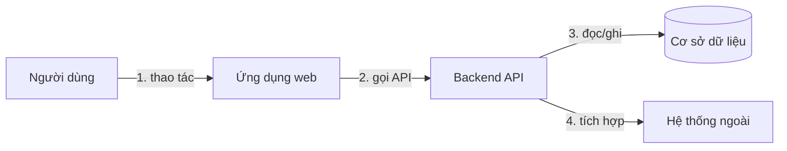

# Solution approach — <Tên dự án>

> Viết bởi skill `sa-solution-design` (`/sa-design`). Ngắn gọn: một sơ đồ, các bảng, lý do. Chi tiết dữ liệu ở `data-model.md`, API ở `api-contract.md`, quyết định ở `docs/adr/`.

## 1. Bối cảnh và động lực thiết kế
| Động lực (driver) | Nguồn | Ảnh hưởng tới thiết kế |
|---|---|---|
| | REQ-… / NFR-… / ràng buộc | |

## 2. Sơ đồ giải pháp (component + data flow)
<!-- MỘT sơ đồ đơn giản: các thành phần chính, hệ thống ngoài, luồng dữ liệu đánh số khớp mục 4. -->

## 3. Thành phần chính
| Thành phần | Trách nhiệm | Công nghệ | REQ phục vụ |
|---|---|---|---|
| | | | |

## 4. Luồng dữ liệu chính
| # | Luồng | Từ → Đến | Dữ liệu | Đồng bộ/bất đồng bộ | Ghi chú bảo mật/toàn vẹn |
|---|---|---|---|---|---|
| 1 | | | | | |

## 5. Tech stack và lý do chọn
| Lớp | Lựa chọn | Lý do chính | Phương án đã loại | ADR |
|---|---|---|---|---|
| Frontend | | | | ADR-001 |
| Backend | | | | ADR-001 |
| Cơ sở dữ liệu | | | | |
| Hạ tầng / triển khai | | | | |

## 6. Phân quyền
| Vai trò (SRS mục 3) | Tài nguyên / chức năng | Quyền (xem/tạo/sửa/xoá/duyệt) | Ràng buộc chủ sở hữu | REQ |
|---|---|---|---|---|
| | | | | |
- Cơ chế xác thực: …
- Điểm thực thi phân quyền: … (vd mọi endpoint qua middleware; kiểm tra chủ sở hữu ở tầng service)

## 7. Bảo đảm toàn vẹn dữ liệu
| Rủi ro toàn vẹn | Cơ chế | Vị trí thực thi | Kiểm chứng |
|---|---|---|---|
| Dữ liệu không hợp lệ | validation 2 lớp (API + ràng buộc DB) | | |
| Ghi đồng thời | transaction / optimistic locking | | |
| Gửi lặp | idempotency key | | |
| Truy vết thay đổi | audit log | | |

## 8. Đáp ứng NFR
| NFR | Nhóm | Cơ chế / quyết định thiết kế | Cách kiểm chứng | ADR |
|---|---|---|---|---|
| NFR-… | Reliability | | | |
| NFR-… | Maintainability | | | |
| NFR-… | Security | | | |
| NFR-… | Data integrity | | | |

## 9. Rủi ro kỹ thuật và giả định
| Rủi ro / giả định | Ảnh hưởng | Giảm thiểu | RAID / ASM |
|---|---|---|---|

## 10. Chỉ mục quyết định kỹ thuật
| ADR | Tiêu đề | Trạng thái |
|---|---|---|
| ADR-001 | Chọn tech stack và kiến trúc nền | Proposed |

## 11. Lịch sử phiên bản
| Version | Ngày | Thay đổi | Nguồn (CR/ADR) |
|---|---|---|---|
| 0.1.0 | 2026-10-11 | Khung ban đầu | — |
