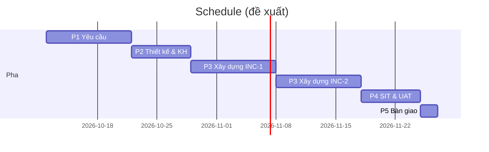

# Project plan — <Tên dự án>

> Đề xuất bởi planner-agent (`/pm-plan`), vai PM chốt. Vòng đời: `docs/process/lifecycle.md`.
> Mọi con số có nguồn; ước lượng của AI ghi "AI ước lượng" cho đến khi PM xác nhận.

## 1. Định hướng scope
- Target scope: SRS v… — <n> REQ (Must <a> · Should <b> · Could <c>), <m> NFR.
- Mục tiêu giải pháp: OBJ-… (problem-statement.md).
- Ràng buộc chính (thời hạn, ngân sách, nguồn lực, công nghệ): …

### 1.1 Thứ tự ưu tiên
| Hạng | REQ / gói việc | Giá trị nghiệp vụ (1–5) | Ràng buộc / hạn | Phụ thuộc | Rủi ro | Lý do xếp hạng |
|---|---|---|---|---|---|---|
| 1 | | | | | | |

## 2. Estimate toàn bộ target scope
- Phương pháp: bottom-up theo WBS, ba điểm (O/M/P → E = (O + 4M + P) / 6).
| Nhóm | Giờ (E) | % |
|---|---|---|
| Quản lý dự án (PM) | | |
| Yêu cầu (BA) | | |
| Thiết kế (SA) | | |
| Xây dựng (Dev) | | |
| Kiểm thử (Test) | | |
| **Cộng** | | |
| Dự phòng thay đổi (CR) — 15–20% | | |
| Dự phòng rủi ro (theo RAID) | | |
| **Tổng có dự phòng** | | |

## 3. WBS
| WBS | Gói việc / deliverable | REQ / US | Vai | O | M | P | E (giờ) | Phụ thuộc trước | Pha / đợt |
|---|---|---|---|---|---|---|---|---|---|
| 1 | Quản lý dự án | — | PM | | | | | — | xuyên suốt |
| 2 | Yêu cầu | — | BA | | | | | 1 | P1 |
| 3 | Thiết kế | — | SA | | | | | 2 | P2 |
| 4 | Xây dựng | US-… | Dev | | | | | 3 | P3 |
| 5 | Kiểm thử (SIT, regression, UAT) | — | Test | | | | | 4 | P4 |
| 6 | Bàn giao | — | PM | | | | | 5 | P5 |

## 4. Thứ tự thực hiện và phụ thuộc
- Đường găng: …
- Phụ thuộc bên ngoài (DEP-…): …

## 5. Schedule và mốc
| Mốc / gate | Ngày kế hoạch | Ngày thực tế | Tiêu chí (phase-gates.md) | Người duyệt |
|---|---|---|---|---|
| G0 Kickoff | | | | PM, Khách |
| G1 Baseline yêu cầu | | | | BA, PM, Khách |
| G2 Baseline thiết kế & kế hoạch | | | | SA, PM (+ Khách) |
| G3 Hoàn tất xây dựng | | | | Dev, SA, Test |
| G4 Nghiệm thu UAT | | | | Test, PM, Khách |
| G5 Bàn giao | | | | PM, SA, Khách |

### 5.1 Đợt xây dựng (hybrid — increment)
| Đợt | Từ – đến | Gói WBS / US | Mục tiêu demo với khách |
|---|---|---|---|
| INC-1 | | | |

## 6. Phân bổ nguồn lực
Chế độ một người: một quỹ giờ chung, chia theo vai. Giờ khả dụng/tuần = <giờ> × focus 0.7.
| Pha | Tuần | PM | BA | SA | Dev | Test | Tổng | % quỹ |
|---|---|---|---|---|---|---|---|---|
| | | | | | | | | |

Chi phí quy trình (gate, review local, họp khách) ~10% đã tính trong từng pha.

## 7. Team responsibilities (RACI)
R = thực hiện · A = chịu trách nhiệm/duyệt · C = tham vấn · I = được thông báo
| Deliverable | PM | BA | SA | Dev | Test | Khách |
|---|---|---|---|---|---|---|
| Project plan, tracking, RAID | A/R | C | C | I | C | I |
| Problem statement, SRS, US/AC | C | A/R | C | I | C | A (G1) |
| Solution approach, data model, API, ADR | C | C | A/R | C | I | C (G2) |
| Code, unit test, review record | I | I | C | A/R | C | — |
| Test case, regression, SIT | I | C | I | C | A/R | — |
| UAT | A | R | I | C | R | A |
| CR: phân tích tác động | A | R | R | C | R | C/A (large) |

Agent tương ứng: planner-agent (PM), analysis-agent (BA), architect-agent (SA), coder-agent + reviewer-agent (Dev), test-agent (Test).

## 8. Scope điều chỉnh / defer
| ID | Hạng mục (REQ/US) | Loại (điều chỉnh / defer / bỏ) | Lý do | Rủi ro | Ảnh hưởng tới test | Quyết định | Ngày |
|---|---|---|---|---|---|---|---|
| | | | | | | DEC-… | |

## 9. Lịch sử baseline kế hoạch
| Version | Ngày | Thay đổi | Lý do / DEC |
|---|---|---|---|
| 0.1.0 | 2026-10-11 | Khung ban đầu | — |
