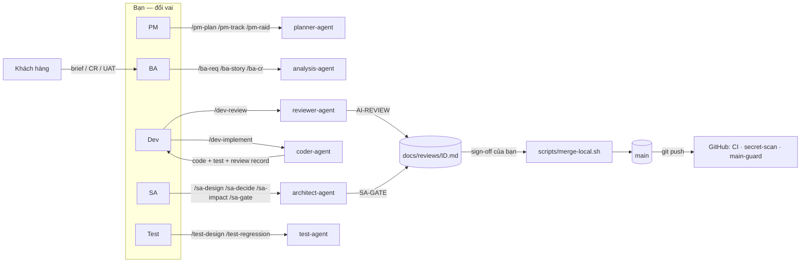

# Quy trình làm việc với AI agent

> Quyết định nền tảng: `ADR-000` (mô hình agent), `ADR-002` (một người), `ADR-003` (hybrid + review local).
> Vòng đời: `lifecycle.md`. Cách làm hằng ngày: `solo-mode.md`. Owner tài liệu: vai PM.

## 1. Mô hình
- **6 agent cho 5 vai, kích hoạt thủ công.** Agent chạy khi bạn gõ lệnh. Không orchestrator, không agent nào tự gọi agent khác.
- **Skill là "cách làm chuẩn".** Agent đọc skill để làm việc; bạn cũng có thể gọi skill trực tiếp trong phiên chính.
- **Bạn duyệt mọi đầu ra.** Agent tạo bản nháp (`Draft`, `Analyzed`, `Proposed`) và `git add`. Bạn đổi trạng thái theo vai, commit, tick sign-off, merge.
- **Gate độc lập thay cho người review thứ hai.** `reviewer-agent` và `architect-agent` (GATE) chỉ đọc, chạy trong context riêng; báo cáo ghi vào review record làm bằng chứng cho `merge-local.sh`.

## 2. Bảng lệnh theo vai và pha
| Vai | Lệnh | Pha | Đầu ra |
|---|---|---|---|
| PM | `/pm-plan stakeholders` · `/pm-plan` · `/pm-plan replan CR-xxx` | P0–P2, khi có CR | Stakeholder register, project plan |
| PM | `/pm-track` | P3–P5 hằng tuần, trước gate | tracking, STATUS-<ngày> |
| PM | `/pm-raid add …` · `review` · `decision …` | mọi pha | RAID, decision log |
| BA | `/ba-req problem` · `srs` · `ad` · `trace` | P1 | Problem statement, SRS, A&D log |
| BA | `/ba-story REQ-xxx` | P1 | US-xxx (Draft) |
| BA | `/ba-cr <mô tả>` · `/ba-cr CR-xxx apply` | sau G1 | CR (Analyzed); SRS/AC cập nhật có đánh dấu |
| SA | `/sa-design [approach\|data\|api\|all]` | P2 | `docs/design/*` |
| SA | `/sa-decide <tiêu đề \| ADR-xxx>` | P2, khi cần | ADR (Proposed) |
| SA | `/sa-stack-setup` | P2, một lần | nhánh gắn stack |
| SA | `/sa-impact CR-xxx [apply]` | sau G1 | CR mục 5; thiết kế cập nhật |
| SA | `/sa-gate [nhánh]` | P3, P0/vùng nhạy cảm | `SA-GATE:` trong review record |
| Dev | `/dev-implement US-xxx` | P3 | Code + test + review record (staged) |
| Dev | `/dev-review [nhánh]` | P3, trước merge | `AI-REVIEW:` trong review record |
| Dev | `/dev-update-docs [ID \| release-notes INC-n]` | P3, P5 | Tài liệu, release notes |
| Test | `/test-design US-xxx [automate\|run]` | P1–P4 | TC, test tự động, kết quả |
| Test | `/test-regression <CR-xxx \| US-xxx \| nhánh \| release>` | sau CR, trước SIT | Regression scope |

Tra cứu nhanh: `docs/onboarding/cheatsheet.md`.

## 3. Giám sát theo mức rủi ro
Xem bảng trong `risk-levels.md`. Production luôn cần vai PM + SA duyệt (gate G5).

## 4. Phản hồi và cải tiến
Mỗi finding review ≥ Medium gắn **nguyên nhân gốc**:
| Nguyên nhân | Vai xử lý | Hành động |
|---|---|---|
| intent-gap | BA | Làm rõ AC/SRS (sau baseline → CR) |
| skill-gap | Dev (phụ trách skill) | Sửa skill/CLAUDE.md (làn nhanh nếu chặn công việc) |
| config-error | SA | Sửa hooks, permissions, script |
| model-limitation | Dev | Ghi nhận; thêm kiểm tra tự động hoặc bước dừng |
| human-error | — | Ghi nhận |
Dữ liệu này đọc từ `docs/reviews/*.md` trong retro cuối mỗi đợt INC-n và đưa vào health check (chiều Quality).

## 5. Lộ trình mở rộng tự động hoá
| Bước | Mở rộng | Điều kiện vào |
|---|---|---|
| Hiện tại | Bạn duyệt toàn phần, agent thủ công, gate độc lập ghi vào review record | — |
| Bước 2 | Coverage gate trong `merge-local.sh`; CD lên môi trường dev/staging | ≤ 15% finding Blocker/High do code AI hai đợt liền; stack đã gắn; `audit-main.sh` sạch |
| Bước 3 | P2/P3: review theo mẫu thay vì 100%; cân nhắc chuỗi agent có điều phối | ≤ 10% ba đợt liền; không sự cố bảo mật |
Mỗi bước mở rộng cần một ADR mới (vai SA + PM ký).

## 6. Điều KHÔNG làm
- Không để agent commit, merge, push main, deploy, hay tự đổi trạng thái `Ready`/`Baselined`/`Approved`/`Accepted`/`Done`.
- Không tick sign-off khi chưa chạy gate tương ứng; không sửa code sau gate mà không chạy lại gate.
- Không code tính năng trước G2 (spike/POC trên nhánh riêng, không merge).
- Không dán secret hay dữ liệu thật của khách vào prompt.
- Không sửa skill trực tiếp trên `main` (theo `skill-governance.md`).
