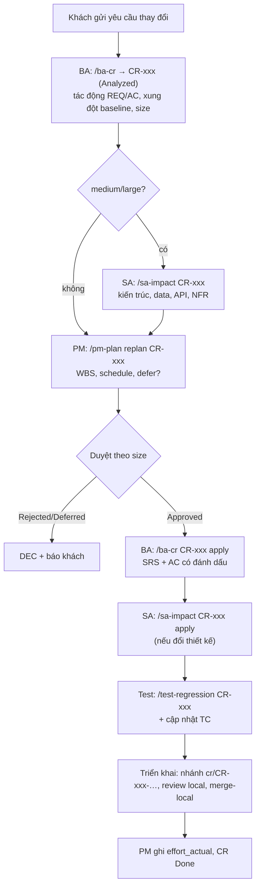

# Quy trình Change Request (CR) — kiểm soát thay đổi so với baseline

> Owner: PM (quy trình) + BA (nội dung). Áp dụng từ sau G1 (baseline yêu cầu). Thống nhất với khách tại kickoff (mục 6).

## 1. Luồng

## 2. Phân loại và vai duyệt
| Size | Dấu hiệu | Vai duyệt (`approved_by`) | Phân tích bắt buộc | Version SRS |
|---|---|---|---|---|
| small | Text, nhãn, bố cục UI, validation đơn giản; không đổi API/data model/luồng/NFR | BA | BA, Test | MINOR |
| medium | Logic trong một module/luồng; field không bắt buộc; đổi ngưỡng NFR không đổi kiến trúc | SA + PM | BA, SA (`/sa-impact`), Test, PM | MINOR |
| large | Kiến trúc, data model, API contract, tích hợp mới, tính năng mới, ≥ 2 module, đổi scope/OBJ | PM + SA + Khách | BA, SA, Test, PM (replan) | MAJOR |
Nghi ngờ → mức cao hơn. CR large có phần small làm ngay được → tách CR.

> **Chế độ một người:** "người duyệt" là VAI bạn đóng. `trace-check` kiểm tra đủ vai theo size và **chặn duyệt CR medium/large khi chưa có `/sa-impact`** (marker `PENDING: /sa-impact`). Khách duyệt CR large: lưu bằng chứng ở mục 12 và DEC-xxx.

## 3. Trách nhiệm theo mục của file CR
| Mục | Vai | Skill |
|---|---|---|
| 1–4, 6, 7 (BA), 11 | BA | `ba-change-impact` |
| 5 Tác động kỹ thuật | SA | `sa-change-impact` |
| 8 Regression scope | Test | `test-regression-scope` |
| 9 Tác động kế hoạch | PM | `pm-project-plan replan` |
| 12 Quyết định | người dùng theo vai; DEC qua `pm-raid-log` | — |

## 4. Thời hạn mục tiêu (SLA nội bộ)
| Bước | small | medium | large |
|---|---|---|---|
| Ghi nhận | trong ngày | trong ngày | trong ngày |
| Phân tích xong (BA + SA + PM) | ≤ 1 ngày | ≤ 2 ngày | ≤ 3 ngày |
| Quyết định | ≤ 1 ngày | ≤ 2 ngày | theo lịch họp khách (≤ 1 tuần) |

## 5. Quy tắc trong pha Xây dựng
- Dự phòng CR: 20% quỹ giờ trước G2, 15% sau G2 (project-plan mục 2).
- small → có thể vào đợt hiện tại bằng dự phòng; medium/large → đợt sau hoặc replan.
- Hết dự phòng → CR mới chờ, hoặc PM đề xuất defer hạng mục giá trị tương đương (project-plan mục 8, ghi rõ ảnh hưởng tới test, DEC).
- CR chạm P0/P1 (`touches_p0_p1: true`) → triển khai theo HITL đầy đủ (kế hoạch được duyệt, `/sa-gate` trước merge-local).
- Phát hiện hiểu sai khi demo cuối đợt → luôn là CR (dù nhỏ), để baseline và AC có dấu vết.

## 6. Thống nhất với khách tại kickoff (checklist PM)
- [ ] Kênh gửi CR duy nhất và người có quyền gửi CR phía khách (stakeholder register).
- [ ] Bảng size và ai phía khách duyệt CR large.
- [ ] Baseline SRS v1.0.0 ở G1 — từ đó mọi thay đổi là CR.
- [ ] Thời hạn phản hồi (mục 4) và cách khách nhận kết quả phân tích.
- [ ] Nguyên tắc dự phòng và cách tính effort/phí CR (nếu hợp đồng yêu cầu).

## 7. Dữ liệu cần ghi
- `received`, `srs_version`, `decision_date`, `size`, `approved_by`, `decision_ref` — khi quyết định.
- `effort_estimate` — khi phân tích; `effort_actual` — khi đóng; `schedule_impact` — PM.
- Story/AC bị đổi: đánh dấu `[Changed: CR-xxx]` + dòng lịch sử.
Báo cáo trong health check: số CR theo size, effort CR % quỹ, thời gian quyết định trung bình.
