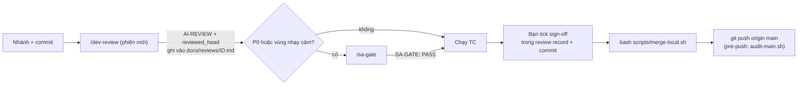

# Git workflow — review local, không Pull Request

> Quyết định: `docs/adr/ADR-003-hybrid-lifecycle-local-review.md` (thay phần PR của ADR-002). Bạn là người duy nhất commit và merge.
> GitHub (nếu dùng) chỉ là nơi backup + chạy CI và `main-guard`. Không mở PR.

## 1. Nhánh
| Loại | Mẫu | Ví dụ |
|---|---|---|
| Story | `feature/US-xxx-mo-ta-ngan` | `feature/US-012-password-reset` |
| Change request | `cr/CR-xxx-mo-ta` | `cr/CR-007-reset-ttl` |
| Bug | `fix/BUG-xxx-mo-ta` | `fix/BUG-031-login-timeout` |
| Tài liệu (BA/PM/SA) | `docs/mo-ta` | `docs/requirements-v1`, `docs/design-v1` |
| Việc chung, cấu hình | `chore/mo-ta` | `chore/stack-setup` |

`main` không nhận commit trực tiếp. Mọi thay đổi vào `main` bằng `scripts/merge-local.sh`.

## 2. Commit
```
<type>(<ID>): <mô tả tiếng Anh, thì hiện tại, ≤ 72 ký tự>

Role: <PM|BA|SA|Dev|Test>
Agent: <analysis-agent|planner-agent|architect-agent|coder-agent|reviewer-agent|test-agent|none>
```
- `feat`, `fix`, `refactor`, `test`, `perf` — **bắt buộc** ID US/CR/BUG; `docs`, `chore`, `ci` — ID tuỳ chọn (có thể ADR/REQ); `merge` — chỉ do `merge-local.sh` tạo.
- Ví dụ:
  ```bash
  git commit -m "docs(US-012): add acceptance criteria" --trailer "Role: BA" --trailer "Agent: analysis-agent"
  git commit -m "feat(US-012): add password reset via email link" --trailer "Role: Dev" --trailer "Agent: coder-agent"
  git commit -m "docs(US-012): add AI review report" --trailer "Role: Dev" --trailer "Agent: reviewer-agent"
  ```
- Agent không tự commit: `git add` + in lệnh đề xuất; bạn chạy (hoặc yêu cầu Claude chạy — Claude Code hỏi xác nhận).

## 3. Review local và merge


1. **Commit hết code** trên nhánh (review chỉ tính code đã commit).
2. **Review record:** `bash scripts/new-doc.sh review` (lấy ID và risk từ nhánh/story). `/dev-implement` thường đã tạo sẵn.
3. **Gate theo mức rủi ro** (`risk-levels.md`) — nên mở phiên Claude Code mới:
   - `/dev-review` → báo cáo (dòng `AI-REVIEW:` + `reviewed_head:`) được ghi vào cuối record;
   - `/sa-gate` → báo cáo (dòng `SA-GATE:` + `reviewed_head:`).
   Commit record (`docs(<ID>): add … report`). Sửa finding → commit → **chạy lại gate** (record mới nhất thắng; code đổi sau `reviewed_head` thì merge-local từ chối).
4. **Test:** `/test-design US-xxx run` hoặc chạy tay; kết quả vào mục "Kết quả test".
5. **Sign-off:** bạn tự đọc diff (`git diff main...HEAD`), tick các ô trong record, commit.
6. **Merge:** trong terminal (không qua Claude):
   ```bash
   bash scripts/merge-local.sh               # nhánh hiện tại; --dry-run để kiểm tra trước
   git push origin main
   git branch -d feature/US-012-password-reset
   ```
   `merge-local.sh` kiểm tra: working tree sạch, nhánh chứa main mới nhất, record hợp lệ (sign-off + bằng chứng còn hiệu lực), lint/test/build, trace-check; rồi `git merge --no-ff` với trailer `Risk:` và `Review-Record:`.
7. Nhánh chỉ sửa `docs/` ngoài vùng nhạy cảm (tài liệu BA/PM/SA): không cần record — `merge-local.sh` ghi `Review-Record: docs-only`. Việc duyệt nội dung tài liệu nằm ở trạng thái của tài liệu (Ready, Baselined, Approved…).

**Nhánh bị tụt sau main** (main có merge mới): `git switch <nhánh> && git merge main`, chạy lại gate nếu code thay đổi. Một người làm tuần tự nên hiếm gặp.

## 4. Kiểm soát
| Lớp | Kiểm soát | Chặn hay phát hiện |
|---|---|---|
| Phiên Claude | permissions + hook: chặn push main, `--no-verify`, chạy `merge-local.sh`, đọc `.env`; hỏi khi sửa vùng nhạy cảm | Chặn |
| Git hook | `pre-commit` (không commit trên main, file cấm, secret), `commit-msg` (định dạng + trailer), `pre-push` (main chỉ nhận merge hợp lệ — `audit-main.sh`) | Chặn trên máy |
| `merge-local.sh` | sign-off + bằng chứng gate theo rủi ro, test, trace | Chặn |
| GitHub (tuỳ chọn) | `CI` (lint/test/build/trace khi push main), `secret-scan`, `main-guard` chạy lại `audit-main.sh` → mở issue `process-violation` | Phát hiện |

Ngoại lệ có chủ đích (chỉ commit khởi tạo): `ALLOW_MAIN_COMMIT=1 git commit …`, `ALLOW_MAIN_PUSH=1 git push -u origin main`.

## 5. Xem lịch sử
```bash
git log main --first-parent --format='%h %ad %s' --date=short       # những gì đã vào main
git log --format='%h %s  [%(trailers:key=Role,valueonly,separator=%x2C)]'
git log main --first-parent --format='%h %s  %(trailers:key=Review-Record,valueonly)'
bash scripts/audit-main.sh                                          # kiểm tra toàn bộ main
```

## 6. Thiết lập một lần
```bash
bash scripts/setup/install-git-hooks.sh
bash scripts/check-env.sh
bash scripts/setup/github-labels.sh      # tuỳ chọn, nếu dùng GitHub issue cho bug/CR và main-guard
```
