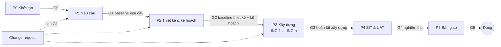

# Vòng đời dự án — hybrid (waterfall theo pha + xây dựng theo đợt)

> Quyết định: `docs/adr/ADR-003-hybrid-lifecycle-local-review.md`. Owner: vai PM.
> Gate và tiêu chí vào/ra: `docs/process/phase-gates.md`. Pha hiện tại: `current_phase` trong `docs/pm/project-plan.md`.

## 1. Vì sao hybrid
- **Phần waterfall:** yêu cầu, thiết kế và kế hoạch được làm đủ trước khi code và **baseline** (khách ký). Estimate dựa trên toàn bộ scope; mọi thay đổi sau baseline là change request có phân tích tác động.
- **Phần agile:** pha Xây dựng chia **đợt (INC-n) 1–2 tuần**, mỗi đợt kết thúc bằng demo với khách. Phát hiện hiểu sai sớm mà không phá baseline: hiểu sai → CR.
- Không có sprint, velocity, sprint planning. Theo dõi bằng WBS + tracking + health check.

## 2. Các pha

| Pha | Mục tiêu | Vai chính | Lệnh | Deliverable |
|---|---|---|---|---|
| **P0 Khởi tạo** | Hiểu bối cảnh, người liên quan, rủi ro đầu | PM | `/pm-plan stakeholders`, `/pm-raid add …`, `/pm-plan` (sơ bộ) | Stakeholder register, RAID ban đầu, kế hoạch sơ bộ, kickoff |
| **P1 Yêu cầu** | Baseline yêu cầu đo được | BA (+ Test review) | `/ba-req problem`, `/ba-req srs`, `/ba-story REQ-…`, `/ba-req ad`, `/ba-req trace`, `/test-design US-…` | Problem statement, SRS (FR/NFR, scope), A&D log, user story + AC, TC nháp |
| **P2 Thiết kế & kế hoạch** | Baseline thiết kế và kế hoạch toàn scope | SA, PM | `/sa-design all`, `/sa-decide ADR-001`, `/sa-stack-setup`, `/pm-plan` | Solution approach, data model, API contract, ADR, stack gắn vào repo; project plan (WBS, estimate, schedule, nguồn lực, RACI); test strategy |
| **P3 Xây dựng** | Code theo đợt, mỗi story qua review local | Dev, Test, SA | `/dev-implement`, `/dev-review`, `/sa-gate`, `/test-design … run`, `merge-local.sh`, `/pm-track` hằng tuần | Code + test trên main, review record, demo cuối đợt |
| **P4 SIT & UAT** | Kiểm thử hệ thống, khách nghiệm thu | Test, BA, khách | `/test-regression release`, `/test-design … run` | Kết quả SIT, biên bản UAT, bug đã xử lý |
| **P5 Bàn giao** | Phát hành, đóng dự án | PM, SA, Dev | `/dev-update-docs release-notes …`, `/pm-track` | Release notes, tài liệu vận hành, bài học kinh nghiệm |

## 3. Nhịp làm việc trong pha Xây dựng (một người)
| Nhịp | Việc |
|---|---|
| Mỗi story | nhánh → `/dev-implement` → commit → phiên mới `/dev-review` (+ `/sa-gate`) → chạy TC → tick sign-off → `merge-local.sh` → push |
| Hằng ngày (5′) | cập nhật status story; phân loại CR mới (small dùng dự phòng) |
| Hằng tuần (30′) | `/pm-track` (tracking + health check), `/pm-raid review` |
| Cuối đợt INC-n | demo với khách; ghi phản hồi (hiểu sai → CR); 20′ retro: finding `skill-gap` → sửa skill (`skill-governance.md`) |
| Trước mỗi gate | `/pm-track`, kiểm tiêu chí trong `phase-gates.md`, `/pm-raid decision G…` |

## 4. Baseline và kiểm soát thay đổi
| Baseline | File | Chốt ở | Version |
|---|---|---|---|
| Yêu cầu | `srs.md`, `problem-statement.md` | G1 | 1.0.0; CR small/medium → MINOR, large → MAJOR |
| Thiết kế | `docs/design/*.md` | G2 | 1.0.0; đổi theo CR (`/sa-impact … apply`) hoặc ADR |
| Kế hoạch | `docs/pm/project-plan.md` | G2 | 1.0.0; rebaseline ghi DEC-xxx |

Thay đổi sau baseline: `docs/process/change-request.md` (BA → SA → Test → PM → duyệt theo size → áp dụng có đánh dấu).

## 5. Quy tắc "đủ tốt" cho một người
- Tài liệu ngắn, dạng bảng; không viết lại nội dung đã có ở file khác — tham chiếu ID.
- Pha có thể chồng lấn nhẹ (vd SA bắt đầu ADR-001 khi SRS gần xong), nhưng **không code tính năng trước G2**. Ngoại lệ: spike/POC trên nhánh `chore/spike-…`, không merge vào main.
